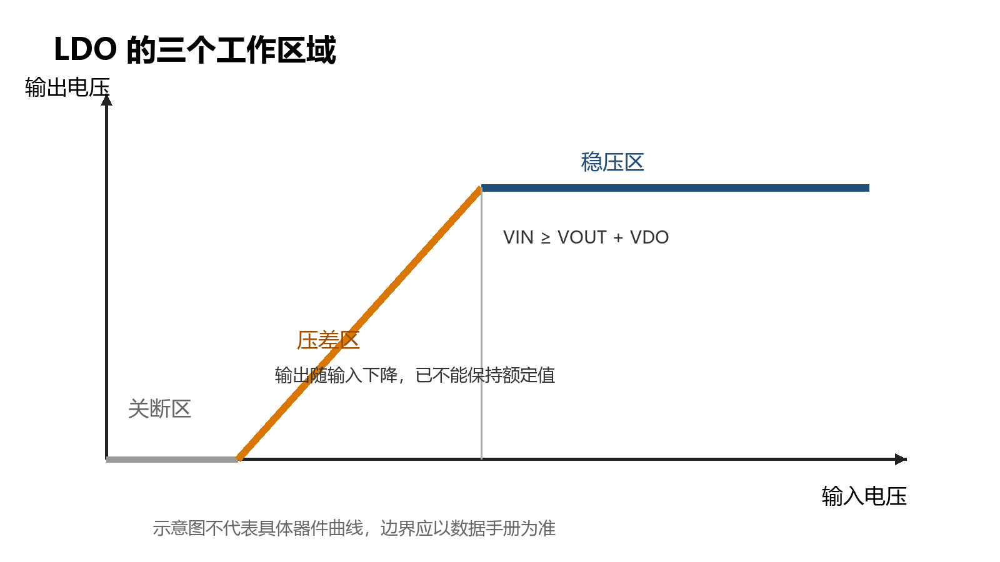
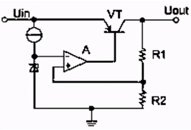
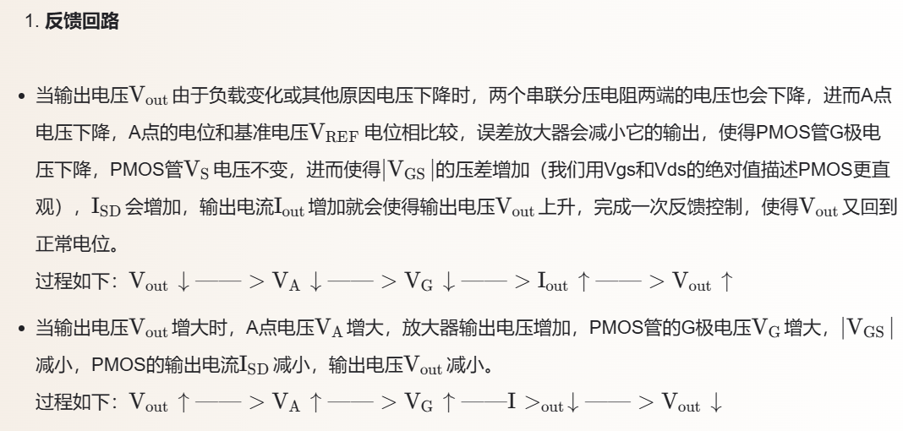
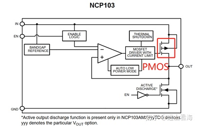
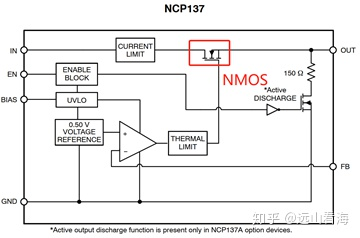
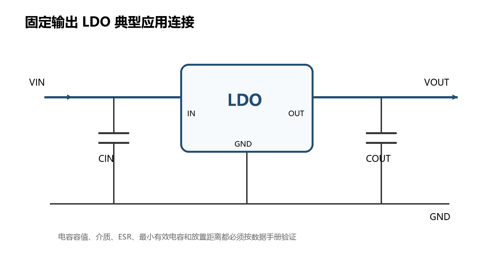

# LDO 线性稳压器学习笔记与设计实践

[下载 Word 版](LDO电路学习笔记与设计实践.docx)

面向硬件实习与初级硬件工程岗位的学习版本

本笔记保留原文的知识主线和全部截图，并补充选型计算、稳定性、热设计、PCB 布局、测量方法和求职项目表达。

学习文档 2026

## 阅读说明

LDO 的核心任务是在输入电压、负载电流和环境温度变化时维持稳定输出。真正完成一次 LDO 设计，不能只看额定输出电压和最大电流，还要同时检查压差、功耗、结温、输出电容稳定范围、瞬态响应、静态电流、PSRR、噪声和 PCB 布局。

这份笔记适合按“理解原理、读懂参数、完成计算、搭建测试、形成项目材料”的顺序学习。文中的典型数值仅用于演示，实际设计必须以目标器件最新版数据手册中的最坏值和测试条件为准。

### 学习路径

1. 先理解 LDO 的闭环稳压过程以及稳压区、压差区和关断区。
1. 掌握数据手册中的关键参数，特别是压差、电容稳定性、热阻和 PSRR 的测试条件。
1. 用最坏情况计算验证输入余量、功耗和结温，再完成原理图与 PCB 布局。
1. 搭建可复现的测试，记录线性调整率、负载调整率、瞬态、纹波、温升和启动波形。
1. 把设计假设、计算、波形和问题闭环整理成可以用于面试讨论的项目材料。

### 内容导航

| 章节 | 学习重点 |
| --- | --- |
| 1 基本概念 | LDO 的定义、使用场景和工作区域 |
| 2 工作原理 | 内部结构、负反馈和调整管类型 |
| 3 主要参数 | 数据手册参数的含义和相互关系 |
| 4 选型计算 | 压差、效率、功耗、结温和最坏情况 |
| 5 稳定性 | 输入输出电容、ESR、噪声与瞬态 |
| 6 应用与布局 | 典型电路、原理图检查和 PCB 布局 |
| 7 测试排查 | 测试方法、仪器连接和常见故障 |
| 8 与 DC DC 对比 | 架构选择和两级电源方案 |
| 9 求职实践 | 项目任务、交付物、简历模板和面试题 |
| 10 检查清单 | 从需求到量产前验证的完整核对 |

## 1 LDO 基本概念

### 1.1 定义与用途

LDO 是 Low Dropout Regulator 的缩写，中文通常称为低压差线性稳压器。它通过调整串联在输入与输出之间的功率器件，使反馈电压保持在内部基准附近，从而稳定输出电压。与传统线性稳压器相比，LDO 能在较小的输入输出压差下继续调节。

例如，传统 78xx 系列通常需要较大的输入余量。若要把 5 V 转换为 3.3 V，输入输出之间只有 1.7 V，部分传统稳压器可能无法保证调节；适当选择的 LDO 可以在更小余量下工作。是否满足要求不能只凭“LDO”名称判断，必须对照压差的最坏值、负载电流和温度条件。

- 低压差表示维持稳压所需的最小输入输出电压差较小，不等同于输出电压本身很低。
- 线性表示调整管连续工作并消耗压差对应的功率，器件可能是 MOSFET，也可能是双极型晶体管。
- 稳压表示闭环控制会抑制输入变化和负载变化，但抑制能力受频率、环路增益和工作区域限制。

### 1.2 适合使用 LDO 的场景

- 输入电压与输出电压接近，负载电流不大，线性损耗可以接受。
- 模拟、射频、时钟、ADC、传感器等电路对噪声和纹波敏感。
- 需要简单、低器件数、低 EMI 的电源轨。
- 在开关电源之后进行后级净化，降低低频纹波和宽带噪声。
- 电池设备待机时间敏感，需要低静态电流和可靠的使能控制。

*图 1 LDO 的关断区、压差区和稳压区示意*

进入压差区后，环路已经无法维持额定输出，VOUT 会随着 VIN 继续下降。此时数据手册中的输出精度、线性调整率、负载调整率、PSRR 和噪声等指标通常不再具有原来的意义。

## 2 工作原理与内部结构

### 2.1 典型内部结构

典型 LDO 包含基准源、误差放大器、反馈网络、串联调整管以及保护电路。误差放大器比较反馈电压与基准电压，并改变调整管的导通程度。限流、短路保护、过温关断、欠压锁定和输出主动放电是否存在，要以具体器件为准。

*图 2 原文截图 LDO 基本反馈结构*

固定输出器件把反馈分压网络集成在芯片内部。可调输出器件通常从外部 FB 引脚采样，理想情况下可按下式设置输出电压；实际还要计入 FB 偏置电流、电阻误差以及器件规定的电阻范围。

VOUT = VREF × (1 + R1 / R2)

### 2.2 负反馈过程

*图 3 原文截图 PMOS LDO 的反馈过程*

以原图中的 PMOS 高边调整管为例，当 VOUT 因负载加重而下降时，反馈电压随之下降，误差放大器改变栅极驱动，使 PMOS 导通增强，输出电流增加并把 VOUT 拉回设定值。当 VOUT 升高时，控制动作相反。实际瞬态波形会受到环路带宽、输出电容、负载跃变速度、寄生参数和限流状态影响。

### 2.3 不同调整管架构

*图 4 原文截图 NCP103 的 PMOS 调整管结构*

*图 5 原文截图 NCP137 的 NMOS 调整管与独立偏置电源结构*

| 架构 | 驱动特点 | 主要优点 | 需要注意 |
| --- | --- | --- | --- |
| PMOS | 高边 P 沟道 MOS，栅极向低电位驱动 | 无需高于 VIN 的栅极驱动，结构常见 | 导通电阻随工艺、温度和电流变化；大电流并非由架构名称直接决定 |
| NMOS | 高边 N 沟道 MOS，通常需要升压驱动或独立偏置 | 较低导通电阻，适合低压大电流或超低压差方案 | 必须检查 VBIAS、启动顺序、压差定义和偏置掉电行为 |
| PNP | 基极电流控制的高边双极型器件 | 可实现较低压差，传统方案较常见 | 负载增大时基极电流可能提高静态电流，热稳定性和反向电流需关注 |
| NPN | 射极跟随或复合管结构 | 控制简单，部分传统线性稳压器采用 | 正输出方案通常需要较大输入余量；是否属于低压差器件应以实际指标判断 |

原文中“PMOS LDO 一般不走大电流”的说法需要加条件。LDO 能否输出大电流取决于调整管尺寸、封装散热、限流设定、压差和允许结温；PMOS 架构同样可以实现安培级输出，但功耗与热设计常成为主要限制。

## 3 数据手册主要参数

读 LDO 数据手册时，先区分绝对最大额定值、推荐工作条件和电气特性。绝对最大额定值只表示器件不应超过的应力边界，不代表可以长期在该点正常工作。电气特性中的典型值用于理解趋势，设计裕量应优先依据规定条件下的最小值或最大值。

| 参数 | 工程含义 | 读取重点 |
| --- | --- | --- |
| 输入电压范围 | 器件允许正常工作的 VIN 范围 | 同时检查绝对最大值、推荐范围、UVLO 和启动条件 |
| 输出电压与精度 | 设定值及其初始误差和全条件误差 | 关注温度、VIN、IOUT 是否计入总精度 |
| 压差 VDO | 维持额定输出所需的最小 VIN−VOUT | 压差依赖负载、温度和架构；典型值不能替代最坏值 |
| 最大输出电流 | 在规定条件下可持续供给的电流 | 可能受封装功耗、限流和压差同时约束 |
| 静态电流 IQ | LDO 自身从输入吸收且未送到负载的电流 | 查看轻载、满载、压差区和温度下的变化 |
| 关断电流 | EN 关闭后仍消耗的输入电流 | 电池设备要同时检查引脚漏电和输出放电路径 |
| 线性调整率 | VIN 改变引起的 VOUT 变化 | 测试必须处于稳压区，并注意 VIN 扫描范围 |
| 负载调整率 | IOUT 改变引起的 VOUT 变化 | 区分稳态指标和负载瞬态峰值 |
| PSRR | 输入纹波传到输出的衰减能力 | 必须按频率、压差、输出电容和负载读取曲线 |
| 输出噪声 | 器件内部噪声在指定带宽内的积分值 | 噪声不是 PSRR；确认带宽、CNR、CFF 和负载条件 |
| 瞬态响应 | 负载或输入突变时的过冲、欠冲和恢复时间 | 比较测试电路、阶跃幅度、边沿速度和电容 |
| 输出电容要求 | 保证稳定性和瞬态性能的电容条件 | 检查容值、有效容值、ESR、介质和允许范围 |
| 限流与短路保护 | 异常负载时限制电流和功耗 | 区分恒流、折返限流和打嗝模式，确认热关断行为 |
| 反向电流 | VOUT 高于 VIN 时可能从输出流向输入的电流 | 电源时序、并联电源和大输出电容场景必须确认 |
| 热阻与结温 | 封装和 PCB 把热量传到环境的能力 | θJA 依赖评估板铜皮和气流，不能脱离测试板照搬 |

### 3.1 压差与负载电流

MOS 调整管在压差区可近似看成导通电阻，因此压差通常随负载电流增大而增大。温度升高也可能使导通电阻增加。选型时要在目标电流和温度下寻找数据手册给出的最大压差，或从保证曲线与设计裕量中推导。

近似关系 VDO ≈ IOUT × RDS(on)

### 3.2 PSRR 与输出噪声

PSRR(dB) = 20 log10(VIN,ripple / VOUT,ripple)

PSRR 描述 LDO 抑制输入纹波的能力，并随频率显著变化。输出噪声描述 LDO 自身产生的噪声，两者不能混为一谈。低噪声设计还应检查基准噪声、误差放大器噪声、反馈电阻热噪声以及 NR 或 CFF 电容的作用。

## 4 选型与最坏情况计算

### 4.1 从需求到器件

1. 列出 VIN 的最小值、典型值、最大值，以及所有上电和掉电时序。
1. 确定 VOUT、允许误差、静态电流和峰值电流，并明确负载阶跃速度。
1. 用最坏压差验证 VIN,min ≥ VOUT,max + VDO,max，并留出走线压降和输入跌落裕量。
1. 计算最大功耗和结温，确认封装、铜皮和环境温度可以承受。
1. 核对输出电容的容值、有效容值、ESR、介质和布局要求。
1. 按频率而不是单点数值核对 PSRR 与噪声，特别是前级开关频率及其谐波。
1. 检查 EN 阈值、启动时间、软启动、放电、反向电流、限流和热关断。
1. 准备至少一个替代料，并比较封装引脚、稳定条件和最坏参数。

### 4.2 功耗与效率

PD ≈ (VIN − VOUT) × IOUT + VIN × IQ

η ≈ (VOUT × IOUT) / [VIN × (IOUT + IQ)]

TJ ≈ TA + PD × θJA

θJA 只能用于初步估算。实际结温与封装焊盘、铜皮面积、过孔、层数、附近热源和气流有关。高风险设计应结合数据手册热模型、评估板布局和实测温升验证。

### 4.3 计算示例

假设用 LDO 把 5.0 V 转为 3.3 V，持续负载 200 mA，IQ 取 50 μA，环境温度 50 °C，初步估算 θJA 为 100 °C/W。该示例只演示计算方法。

| 项目 | 计算 | 结果与判断 |
| --- | --- | --- |
| 压差余量 | VIN−VOUT = 5.0−3.3 | 1.7 V；仍需与目标电流下的 VDO,max 比较 |
| 主要损耗 | (5.0−3.3)×0.2 | 0.34 W |
| 静态损耗 | 5.0×50 μA | 0.00025 W，可忽略但电池待机仍要关注 |
| 近似效率 | 3.3×0.2 ÷ [5.0×(0.2+0.00005)] | 约 66% |
| 结温估算 | 50 + 0.34025×100 | 约 84 °C；需与 TJ,max 和降额目标比较 |

若负载提高到 500 mA，主要损耗增至 0.85 W，按相同 θJA 估算温升约 85 °C。此时即使电气上满足最大输出电流，热设计也可能不再可行。这正是 LDO 选型中最常见的误区之一。

### 4.4 最坏情况表

| 工况 | VIN | IOUT | 温度 | 重点验证 |
| --- | --- | --- | --- | --- |
| 最低输入与满载 | 最小 | 最大 | 高温 | 压差和输出精度 |
| 最高输入与满载 | 最大 | 最大 | 高温 | 功耗、结温和限流 |
| 最高输入与轻载 | 最大 | 最小 | 低温或高温 | 输出偏高、IQ 和最小负载 |
| 快速负载阶跃 | 典型或最差 | 低到高再返回 | 典型与高温 | 欠冲、过冲和恢复时间 |
| 掉电与反向供电 | 快速下降或为 0 | 输出仍有电容或外部电源 | 全温 | 反向电流和器件应力 |

## 5 稳定性与电容选择

LDO 是闭环系统。输出电容及其 ESR 会改变输出极点和零点，直接影响相位裕量和瞬态响应。旧式 LDO 可能要求一定 ESR 范围，现代器件常声明可配陶瓷电容，但仍有最小有效电容、最大电容、ESR 和布局限制。

### 5.1 有效电容而不是标称电容

多层陶瓷电容的实际容值会受到直流偏压、温度、容差和老化影响。标称 1 μF 的电容在工作电压下可能明显低于 1 μF。选型时应查看电容厂商的直流偏压曲线，并保证最坏条件下仍满足 LDO 要求。

- CIN 靠近 IN 与 GND，减小输入走线电感和源阻抗引起的振铃。
- COUT 靠近 OUT 与 GND，反馈地与大电流回流路径分开处理。
- 可调 LDO 的反馈电阻靠近 FB，引线远离开关节点、时钟和大电流铜皮。
- NR、BYP 或 CFF 电容的连接、容值和泄放时间严格按数据手册执行。
- 远端负载若还有大电容或长线，应评估启动、浪涌、环路稳定性和掉电反灌。

### 5.2 稳定性异常的典型表现

- 输出出现持续振荡或固定频率纹波，且对探头接法非常敏感。
- 负载阶跃后产生多次衰减振铃，恢复时间明显长于数据手册示例。
- 更换电容品牌、封装或介质后，输出波形显著改变。
- 空载正常而满载异常，或实验室电源线变长后才出现振荡。

## 6 应用电路与 PCB 布局

### 6.1 典型应用电路

*图 6 固定输出 LDO 的典型连接示意*

固定输出 LDO 的外部器件通常不多，但每个连接都影响性能。EN 不应悬空，若系统不控制使能，应按数据手册上拉或直接连接到允许的电压域。地线应短而低阻，输出采样点应避开大电流回流压降。

### 6.2 原理图检查

- IN、OUT、GND、EN、FB 或 SNS、BIAS、NR 等引脚连接与封装引脚号一致。
- 输入输出电容满足容值、耐压、介质、ESR 和有效容值要求。
- EN 电压不超过引脚额定值，并满足上电、掉电和默认状态需求。
- 可调输出的反馈电阻误差、偏置电流和 CFF 对启动与稳定性的影响已计算。
- 反接、反向电流、外部电源并联和输出预偏置场景已有处理。
- 测试点覆盖 VIN、VOUT、EN、GND；必要时为负载阶跃和电流测量预留位置。

### 6.3 PCB 布局

- 将 CIN 放在 IN 与 GND 引脚旁，将 COUT 放在 OUT 与 GND 引脚旁，回路面积尽量小。
- 高电流输入和输出走线加宽，避免其压降被反馈网络误认为输出变化。
- 散热焊盘按推荐封装连接到足够铜皮，并用热过孔连接内层或背面铜。
- FB 或 SNS 走线从安静的输出点单独引回，远离 DC DC 开关节点和高速数字线。
- 模拟地与大电流地在低阻区域汇合，示波器测试点附近预留可靠地端。

## 7 测试方法与故障排查

### 7.1 建议测试项目

| 测试 | 方法 | 记录内容 |
| --- | --- | --- |
| 输出精度 | 在规定 VIN、IOUT 和温度点测量稳态 VOUT | 平均值、偏差百分比和仪表精度 |
| 线性调整率 | 保持负载不变，扫描稳压区内的 VIN | VIN 与 VOUT 对应表，排除压差区 |
| 负载调整率 | 保持 VIN 不变，逐级改变稳态负载 | IOUT、VOUT 和温升 |
| 负载瞬态 | 用电子负载产生低高电流阶跃 | 阶跃幅度、边沿、过冲、欠冲、恢复时间 |
| 输入纹波与 PSRR | 在直流输入上叠加已知频率的小信号 | 输入输出纹波幅度、频率和负载 |
| 输出噪声 | 按指定带宽和低噪声测量方法测试 | 带宽、探头、前置放大器和 RMS 值 |
| 启动与关断 | 控制 VIN 或 EN，观察 VOUT 和浪涌 | 延时、上升时间、过冲、放电时间 |
| 温升 | 在最大损耗工况稳定后测量 | 环境、壳温、热像图和估算结温 |

### 7.2 示波器连接要点

- 测纹波和瞬态时使用短接地弹簧或同轴连接，避免长地线形成天线。
- 打开带宽限制是否合适要写入测试记录，不能只展示一张没有设置条件的波形。
- 探头直接跨接在输出电容两端，区分电源轨本身与长走线上的压降和噪声。
- 记录电子负载的阶跃边沿和连接线，过长的负载线会改变观测结果。
- 低噪声测量要考虑示波器底噪、探头衰减和外部电磁干扰。

### 7.3 常见故障与排查

| 现象 | 可能原因 | 排查顺序 |
| --- | --- | --- |
| 输出低于设定值 | 进入压差区、限流、走线压降、反馈错误 | 测 VIN 与 IOUT，检查 VDO 和限流，再测芯片引脚电压 |
| 输出振荡 | COUT 或 ESR 不满足要求、布局回路过大、输入源阻抗高 | 核对电容有效值，缩短探头地，替换电容并检查布局 |
| 满载过热 | 压差过大、散热铜皮不足、环境温度高 | 计算 PD，测壳温和输入电流，比较热布局 |
| 启动过冲 | 输出预偏置、软启动与 CFF 组合、反馈延迟 | 同时观察 VIN、EN、VOUT 和负载，核对启动条件 |
| 关断后不掉电 | 无主动放电、负载过轻、外部路径反灌 | 测反向电流路径，确认放电功能与系统时序 |
| 纹波比预期大 | PSRR 在目标频率下降、已接近压差、测量接地不当 | 确认频率与压差，重做短地测量并比较输入纹波 |

## 8 LDO 与 DC DC 的区别

| 维度 | LDO | 降压型 DC DC |
| --- | --- | --- |
| 工作方式 | 调整管在线性区连续消耗压差功率 | 开关管周期导通，通过电感电容传递能量 |
| 效率 | 近似受 VOUT/VIN 限制，压差大时损耗明显 | 在较宽输入输出范围内通常更高，但依赖负载与开关损耗 |
| 纹波与 EMI | 无开关节点，通常较低，但仍有器件噪声和输入纹波穿透 | 存在开关纹波、谐波和 EMI，需要布局与滤波 |
| 器件数量 | 通常少，设计简单 | 需要电感及更多外围器件 |
| 热设计 | 高压差大电流时发热集中在 LDO | 损耗较低但分布在开关管、电感和驱动 |
| 典型用途 | 低噪声、小压差、中小功率、后级净化 | 高效率、大压差、中大功率 |

两者并非只能二选一。常见方案是先用 Buck 把较高输入降到接近目标电压，再用 LDO 为敏感模拟电路供电。前级输出必须给 LDO 留出压差余量，同时要检查 LDO 在开关频率及其谐波处的 PSRR，而不能只看 1 kHz 的单点指标。

## 9 面向求职的实践项目

### 9.1 建议项目

可以完成一个“5 V 输入转 3.3 V 低噪声传感器电源”的小项目。目标不是堆叠器件，而是展示你能够把需求、选型、计算、原理图、PCB、测试和问题闭环串起来。

| 阶段 | 任务 | 交付物 |
| --- | --- | --- |
| 需求 | 定义 VIN 范围、负载、允许误差、噪声、环境和尺寸 | 一页需求表与验收指标 |
| 选型 | 比较至少 3 款 LDO 的最坏参数、供货和封装 | 选型矩阵与淘汰理由 |
| 计算 | 验证压差、效率、功耗、结温、反馈和电容 | 可复核的计算表 |
| 设计 | 绘制原理图和两层或四层 PCB | 原理图、PCB、BOM 和设计检查表 |
| 调试 | 检查上电、稳态、瞬态、纹波和温升 | 原始波形、照片、测试条件和结论 |
| 复盘 | 记录问题、根因、修改和回归验证 | 问题闭环表与最终版本说明 |

### 9.2 可量化的测试目标示例

- 在规定 VIN 与 IOUT 范围内记录输出误差，结果与数据手册精度预算对照。
- 完成 10 mA 到目标峰值电流的负载阶跃测试，标注边沿、过冲、欠冲和恢复时间。
- 在最大功耗工况运行至热稳定，记录环境温度、壳温和热像图。
- 比较两种输出电容或两种布局的瞬态与纹波差异，解释原因。
- 若前级为 Buck，分别测量开关频率附近的输入与输出纹波，估算实际抑制量。

### 9.3 简历表达模板

只有在完成实测后再填写数字，避免把理论值写成项目结果。可以按“任务、方法、结果、改进”组织一到两条经历。

- 设计并验证 [输入范围] 至 [输出电压和电流] 的 LDO 电源，完成压差、功耗、结温和输出电容最坏情况计算，并据此确定 [器件与封装]。
- 搭建线性调整率、负载调整率和负载瞬态测试，实测欠冲 [数值]、恢复时间 [数值]、满载温升 [数值]，通过 [布局或器件修改] 将 [问题指标] 改善 [数值]。
- 定位 [振荡、过热、反灌或启动过冲] 的根因，使用 [波形或对比实验] 验证 [原因]，修改 [电容、反馈、布局或时序] 后完成回归测试。

### 9.4 高频面试问题

| 问题 | 回答要点 |
| --- | --- |
| LDO 为什么会发热 | 压差与负载电流形成主要损耗；还要计入 IQ，并结合热阻估算结温 |
| 压差越小越好吗 | 压差小有利于效率和电池利用，但必须同时看负载、温度、PSRR、瞬态、成本和偏置需求 |
| 为什么换了陶瓷电容会振荡 | 有效容值和 ESR 改变环路极点零点；布局寄生和输入源阻抗也会参与 |
| PSRR 和噪声有什么区别 | PSRR 是输入纹波向输出的传递抑制，噪声是 LDO 自身产生的输出噪声 |
| 如何判断 LDO 还是 Buck | 先看功率与效率，再看噪声、EMI、成本、体积和热；需要时采用 Buck 加 LDO |
| 如何测负载瞬态 | 定义阶跃幅度和边沿，短地探测输出电容两端，同时记录负载波形、欠冲过冲和恢复时间 |
| 为什么最大输出电流不等于可持续电流 | 封装功耗、环境温度、铜皮、压差、限流和结温会共同限制持续电流 |

## 10 设计与调试检查清单

### 10.1 需求与选型

- VIN 最小值、最大值和瞬态已定义；所有电源时序已列出。
- VOUT 精度预算包含初始误差、线性调整、负载调整、温漂和反馈电阻误差。
- 目标电流下的 VDO,max 满足最低输入条件并留有走线与输入跌落裕量。
- 最大功耗和结温按最高 VIN、最大负载和最高环境温度计算。
- 输出电容在直流偏压、温度、容差和老化后的有效值仍满足稳定要求。
- PSRR、噪声和瞬态曲线的测试条件与实际应用接近。

### 10.2 原理图与 PCB

- 引脚、封装、EN 电压域、反馈连接和散热焊盘逐项核对。
- CIN 与 COUT 紧靠引脚，输入输出高电流回路短而宽。
- FB 或 SNS 从安静输出点采样，并远离开关节点。
- 散热铜皮、过孔和地平面符合目标功耗；附近热源已评估。
- VIN、VOUT、EN 和 GND 具备可重复测试的测试点。

### 10.3 测试与发布

- 测试记录包含仪器、探头、带宽、负载边沿、环境和样品版本。
- 已覆盖最低输入满载、最高输入满载、轻载、高温、启动、关断和异常负载。
- 示波器使用短地连接，波形截图包含横纵坐标和触发条件。
- 问题都有根因、修改、回归测试和版本记录。
- 替代料经过引脚、稳定条件、热性能和时序兼容性验证。

## 附录 术语与参考资料

| 缩写 | 含义 |
| --- | --- |
| LDO | Low Dropout Regulator 低压差线性稳压器 |
| VDO | Dropout Voltage 压差 |
| IQ | Quiescent Current 静态电流 |
| PSRR | Power Supply Rejection Ratio 电源抑制比 |
| ESR | Equivalent Series Resistance 等效串联电阻 |
| UVLO | Undervoltage Lockout 欠压锁定 |
| TJ | Junction Temperature 结温 |
| θJA | Junction to Ambient Thermal Resistance 结到环境热阻 |

### 参考资料

1. Texas Instruments, Understanding the Terms and Definitions of LDO Voltage Regulators, SLVA079, https://www.ti.com/lit/an/slva079/slva079.pdf
1. Texas Instruments, LDO Performance Near Dropout, SBVA029, https://www.ti.com/lit/pdf/sbva029
1. Texas Instruments, LDO Basics, https://www.ti.com/product-category/power-management/ldo-basics-ebook.html
1. onsemi, NCP103 Low Dropout Regulator CMOS 150 mA Data Sheet, https://www.onsemi.com/download/data-sheet/pdf/ncp103-d.pdf
1. onsemi, NCP137 LDO Regulator Very Low Dropout CMOS Bias Rail Data Sheet, https://www.onsemi.com/download/data-sheet/pdf/ncp137-d.pdf
器件数据手册会修订。项目选型和发布前应重新下载目标器件的最新版数据手册，并核对订购型号、封装、温度等级和生命周期状态。
